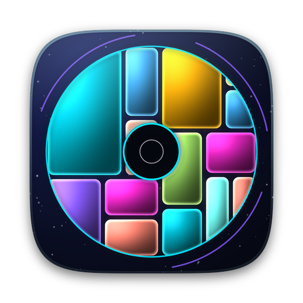
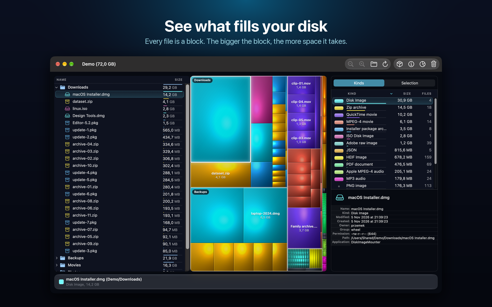
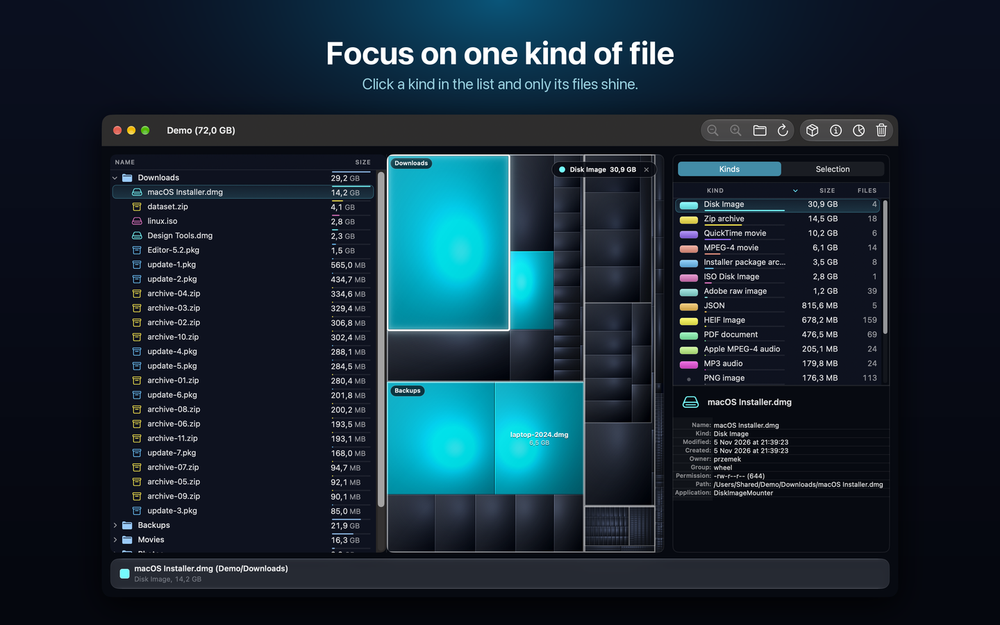
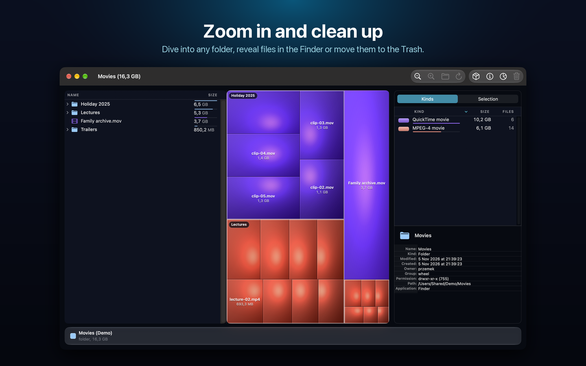

<p align="center">
  
</p>

<h1 align="center">Disk Inventory Xs</h1>

<p align="center">
  <b>See what fills your disk.</b><br>
  A fast, dark, glassy disk-usage map for Apple silicon Macs. Free and open source.
</p>

<p align="center">
  
  
  
</p>

<p align="center">
  
</p>

## What it is

Pick a folder or a whole disk and Disk Inventory Xs draws every file as a block on a **treemap**: the bigger the
block, the more space the file takes. Folders are outlined and named, files of the same kind share a color, and a
click on any block selects the file in the tree. Zoom into a folder, spot the forgotten 14 GB installer and move it
to the Trash, all in one window.

It is a continuation of [Disk Inventory X](http://www.derlien.com) by Tjark Derlien, ported to Swift, rebuilt for
Apple silicon and macOS Tahoe, and improved in three ways: **faster, more stable, and a new look.** The "s" is for
Silicon.

## Features

- **Treemap** with cushion shading, outlined and named folders, names and sizes on big files, and a hover and
  selection glow. Click a block or a row: map, tree and lists stay in sync.
- **File tree** with each item's size, a bar comparing it with the largest item of its folder, and an icon in the
  color of the file's kind.
- **Kinds**: every kind of file (MP3, disk image, PDF ...) with its total size and file count; the **Selection**
  tab lists the files of one kind, and the **Information** card shows everything about the selected item.
- **Focus on one kind**: click a kind in the legend and only its files shine, everything else fades.
- Zoom into folders and out again, **Reveal in Finder**, **Open With**, **Move To Trash**, refresh a folder.
- Show or hide package contents, physical or logical file sizes, free and other space on the map.
- A palette of 12 colors that stays distinguishable for the usual kinds of color blindness
  (`python3 tools/palette_check.py` checks it), Reduce Transparency, Increase Contrast and Reduce Motion support.
- English, German, French and Spanish.
- Private: no network code, no analytics, no accounts. It reads file names, sizes and dates only, in the folders
  you choose.

<p align="center">
  
</p>

## What changed compared with the original

### Faster

The folder scanner reads folders with `getattrlistbulk`, in parallel and off the main thread, and the treemap caches
what its layout asked the data source for over and over, shades the blocks concurrently and finds the block under
the pointer much faster. Measured on a scan of `/Applications` with package contents (900,335 files, 67 GB) on a
MacBook Air with an M4, against the last version before the speed work (2.0.0):

| | Before | Now | |
| --- | ---: | ---: | ---: |
| Scan of the folder | 33.5 s | 3.35 s | **10×** |
| Treemap layout | 280 ms | 19.6 ms | **14×** |
| Drawing the colored blocks | 230 ms | 26.7 ms | **8.6×** |
| Finding the block under 200,000 pointer positions | 685 ms | 90 ms | **7.6×** |

How it was measured, and what was not: [`docs/benchmarks.md`](docs/benchmarks.md).

### More stable

- Fixed a crash when a refreshed or trashed folder changed its size (an unsigned overflow while the sizes were
  propagated to the parent folders).
- Fixed treemap cells that showed content from elsewhere after the pointer moved over them.
- Fixed an image lifetime bug in the list cells, a wrong first-responder call and window observers that listened to
  every window in the treemap view.
- Built natively for Apple silicon with the current tools (macOS 26 and later) and covered by 57 automated tests,
  including tests that pin the layout, the hit-test results and every rendered pixel of a seeded treemap.

### A new look ("Holo Glass")

<p align="center">
  
</p>

A dark, luminous interface on a deep-space canvas with Liquid Glass chrome, a neon palette, a view-based file tree
with colored icons, a sidebar instead of drawers (kinds, selection, information), labels on the map, a new icon
and a rewritten Help. The design notes are in [`CLAUDE.md`](CLAUDE.md).

## Download

**Signed, notarized, ready to run.** Disk Inventory Xs is signed with a Developer ID by **Fundacja Zagle Zycia** and
notarized by Apple, so it opens with a plain double-click: no warnings, no *Open Anyway*, no Terminal tricks.

1. Download [`DiskInventoryXs-2.1.0-arm64.zip`](build/DiskInventoryXs-2.1.0-arm64.zip?raw=true) (version 2.1.0,
   4.7 MB). It is a single file, so you do not need the source.
2. Unzip it and drag **Disk Inventory Xs** to your Applications folder.
3. Open it, pick a folder or a whole disk and watch the map appear.

Requirements: an **Apple silicon Mac** and **macOS 26 (Tahoe) or later**. Folders macOS protects (Photos, Music,
Contacts ...) ask for their usual permission the first time.

Want to check it yourself? The SHA-256 of the zip is
`e8d08c0d3c29c5bd7f20ae8104571a55ff72e370c4c1bece376b76188b87a169`, and once the app is in Applications,
`spctl -a -vv "/Applications/Disk Inventory Xs.app"` answers *accepted, source=Notarized Developer ID*.

Prefer to build it yourself? See below.

## Build from source

```sh
src/BuildRelease.sh        # arm64, ad-hoc signed: src/build/Release/Disk Inventory Xs.app
./run-tests.sh             # the unit tests (it first stops a running "Disk Inventory Xs")
```

`src/BuildRelease.sh` builds the app and signs it ad hoc with Hardened Runtime; point it at a Developer ID identity
with `SIGN_IDENTITY="Developer ID Application: Your Name (TEAMID)"`, and see
[`NOTARIZATION.md`](NOTARIZATION.md) for the notarytool and stapler steps.

The benchmarks (`TreeMapPerformanceTests.testBenchmarkRealFolder`) and the architecture are described in
[`CLAUDE.md`](CLAUDE.md).

## Repository layout

- `src/`: the Swift app (AppKit, `NSDocument` based); the treemap renderer is in `src/TreeMap/`
- `src/Tests/`: the unit tests; `run-tests.sh` runs them
- `tools/`: the icon and palette scripts, the demo folder and screenshot generators
- `docs/`: the benchmarks report and the images used here
- `treemap/` and `DiskInventoryX/`: leftovers of earlier ports (the old Objective-C framework project and an early
  SwiftUI prototype); not part of the build

## Credits

- **Tjark Derlien**: original author of Disk Inventory X (2003–2022)
- **Mahmoud Lababidi**: Apple Silicon port, Xcode 26 warning cleanup, Hardened Runtime fix, notarized release
  pipeline (2026)
- **Przemek Dymarkowski**: developer of this version (2026): faster scanner and treemap, the "Holo Glass" interface,
  and a rewritten Help.

The icon of the original app (from version 1.2 on) was made by Anton Repponen; the current icon is generated by
`tools/make_app_icon.py`.

## License

GPL v3: see [`LICENSE`](LICENSE) and the source headers. Same license as the original. This is a modified version;
the About panel and the `InfoPlist.strings` say so.

## Related

Mahmoud Lababidi's README also mentions a from-scratch SwiftUI rewrite, **Disk Inventory Y**, that lives in a
sibling repository of its own and targets macOS 14 and later.
